# GCD USMBA — Gestion du Cycle Doctoral

**Plateforme web de préinscription et d'inscription au cycle doctoral.**

Projet pédagogique de conception et de développement d'une application web destinée à faciliter la gestion des candidatures au doctorat au sein de l'Université Sidi Mohamed Ben Abdellah (USMBA) de Fès.

> **Note :** Ce projet est un prototype de démonstration non officiel. Il ne constitue pas une plateforme institutionnelle de l'USMBA. Les données et les scénarios présentés sont illustratifs.

## 1. Présentation du projet

L'application GCD USMBA propose une interface centralisée pour accompagner les candidats dans leur parcours de préinscription et d'inscription au cycle doctoral.

Elle permet également aux commissions de sélection d'examiner les candidatures, d'organiser les entretiens et d'établir les classements.

La plateforme est organisée autour de trois espaces :
- Espace Candidat
- Espace Commission de sélection
- Espace Administration

## 2. Objectifs du projet

- Digitaliser le processus de préinscription au doctorat.
- Simplifier la constitution et le suivi des dossiers.
- Permettre la sélection de trois sujets de thèse par ordre de priorité.
- Faciliter la gestion des candidatures et des entretiens.
- Centraliser les évaluations et les classements.
- Illustrer la procédure de validation administrative.

## 3. Fonctionnalités principales

### Espace Candidat
- Consultation des sujets de thèse disponibles.
- Création et gestion du dossier de candidature.
- Saisie des informations personnelles et universitaires.
- Sélection de trois sujets par ordre de priorité.
- Dépôt des pièces justificatives.
- Enregistrement du dossier en brouillon.
- Suivi de la progression de candidature.
- Consultation des notifications.

### Espace Commission de sélection
- Consultation des candidatures regroupées par sujet.
- Examen scientifique des dossiers.
- Présélection des candidats.
- Planning des entretiens.
- Évaluation et classement des candidatures.
- Gestion des listes principales et d'attente.
- Export des résultats au format CSV.

### Espace Administration
- Suivi des candidatures.
- Gestion des règles et des paramètres.
- Vérification des pièces administratives.
- Validation des inscriptions définitives.

## 4. Diagramme d'activité UML

Le diagramme représente le processus de préinscription et d'inscription au cycle doctoral ainsi que les interactions entre le candidat, la plateforme GCD, la commission de sélection et l'administration.

## 5. Captures d'écran de l'application

### 5.1 Page d'accueil

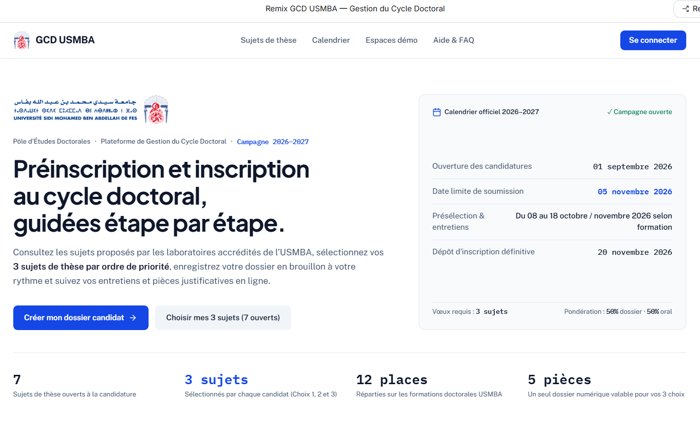

### 5.2 Catalogue des sujets de thèse

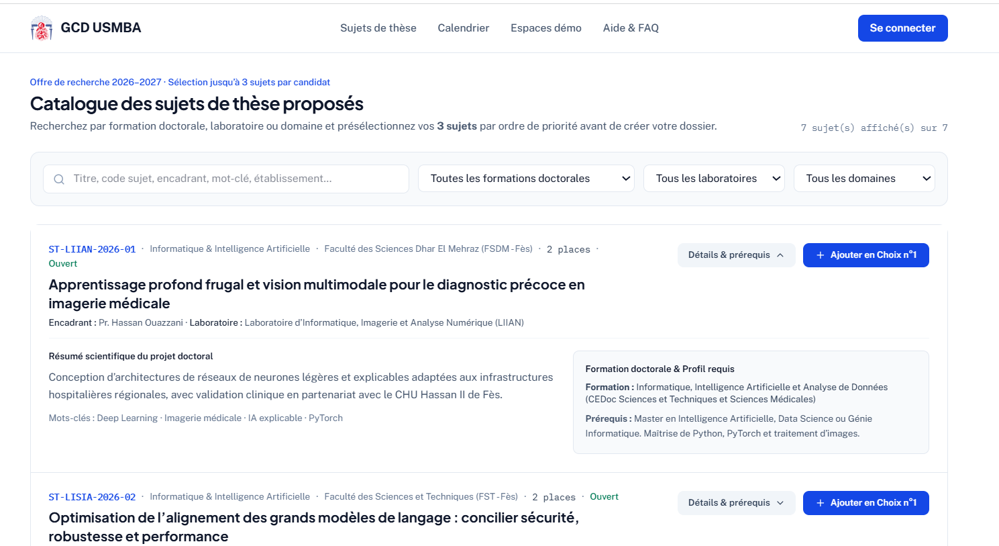

### 5.3 Espaces de démonstration

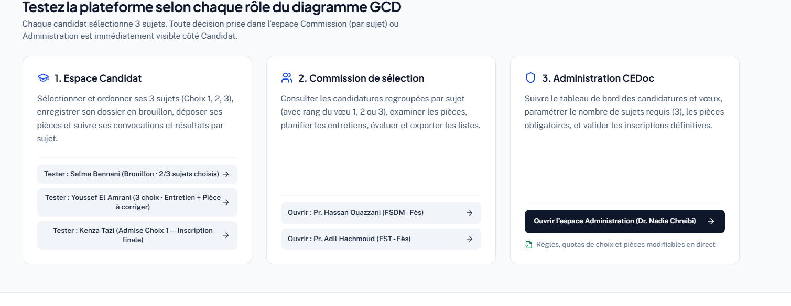

### 5.4 Suivi et progression du candidat

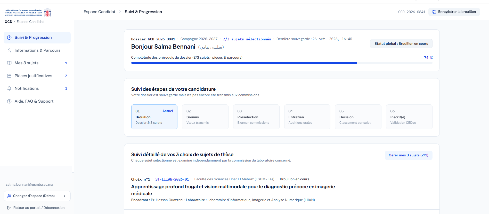

### 5.5 Informations et parcours

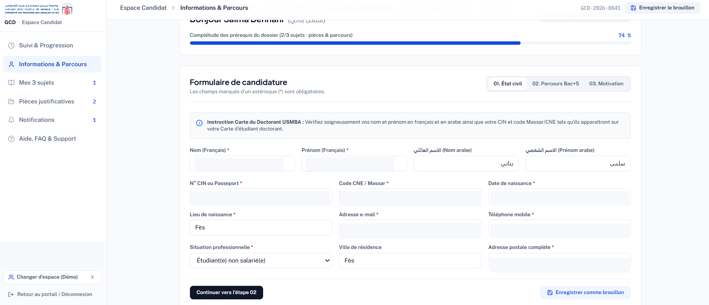

### 5.6 Sélection des sujets

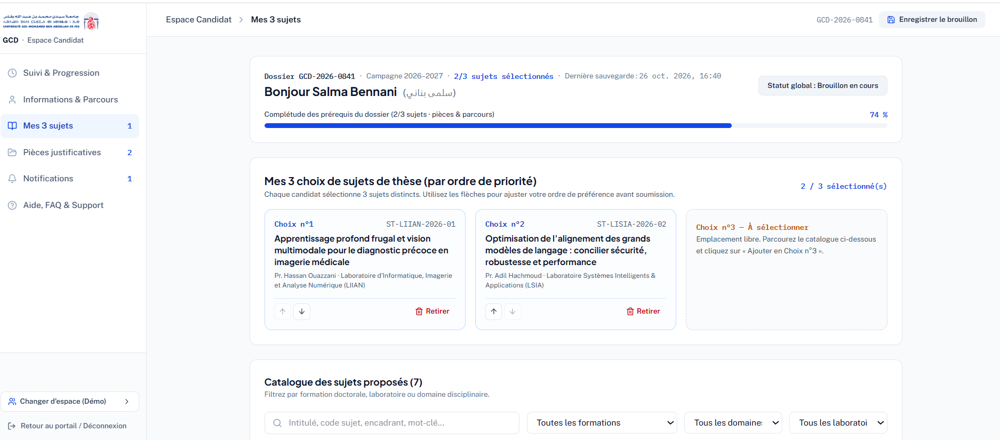

### 5.7 Pièces justificatives

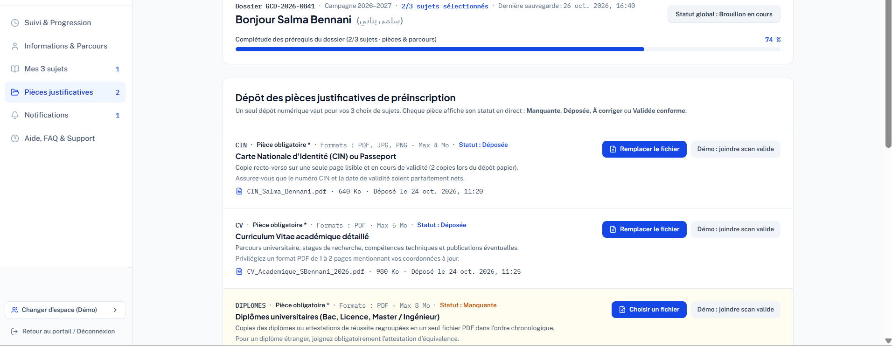

### 5.8 Notifications

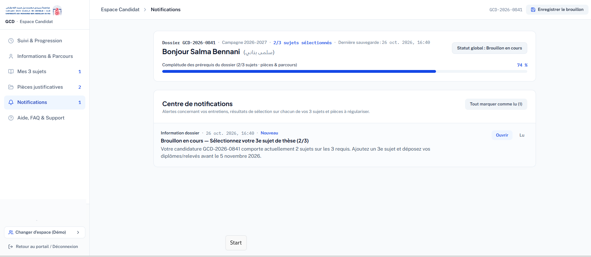

### 5.9 Conseils aux candidats

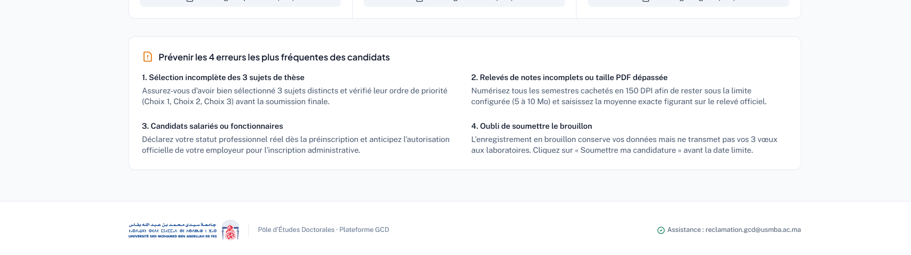

### 5.10 Commission — Candidatures par sujet

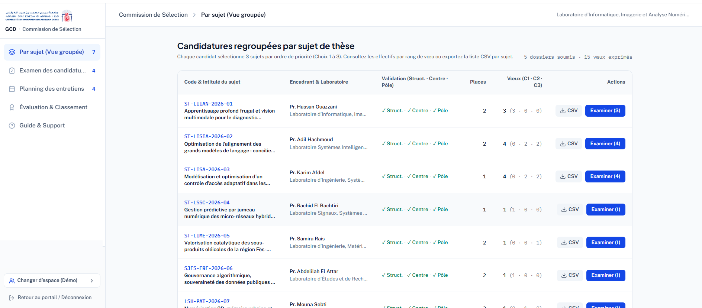

### 5.11 Commission — Examen des candidatures

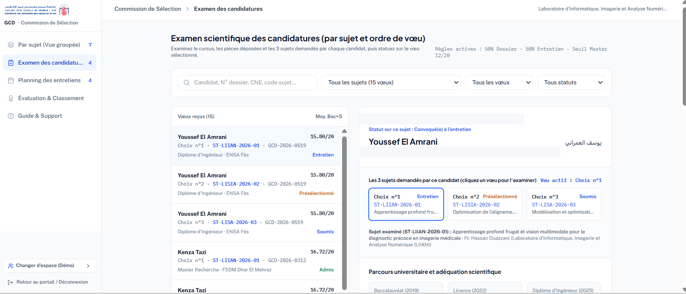

### 5.12 Commission — Planning des entretiens

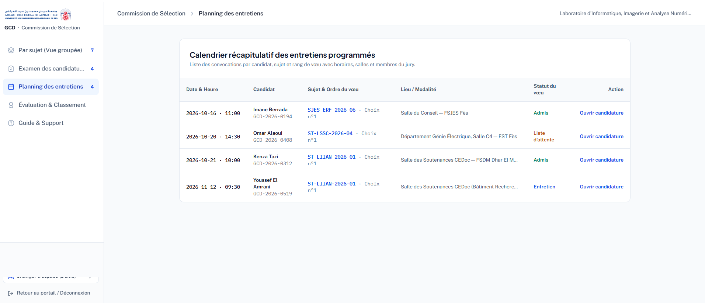

### 5.13 Commission — Évaluation et classement

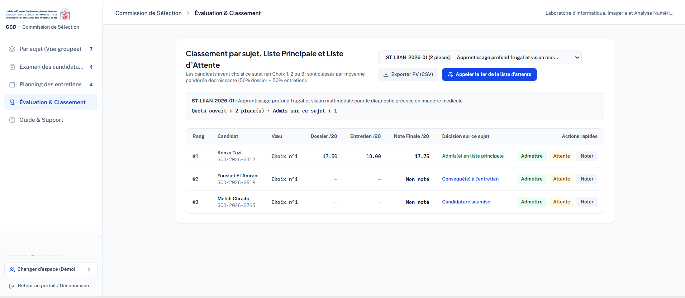

## 6. Processus de fonctionnement

1. Le candidat accède à la plateforme.
2. Il prépare son dossier et choisit ses sujets de thèse.
3. Il soumet sa candidature.
4. La commission examine son dossier.
5. Les candidats présélectionnés participent aux entretiens.
6. La commission évalue et classe les candidats.
7. Les candidats admis préparent leurs dossiers définitifs.
8. L'administration vérifie les pièces et valide les inscriptions conformes.

## 7. Technologies et outils

- Google AI Studio : conception et prototypage de l'application.
- GitHub : hébergement et gestion du code source.
- UML : modélisation du processus.
- Markdown : documentation du projet.

Les technologies exactes utilisées par l'application sont à préciser après vérification du code source.

## 8. Statut du projet

**Prototype pédagogique de démonstration.**

Ce projet présente les interfaces et les parcours principaux de gestion du cycle doctoral. Les tests techniques et la validation pour un environnement de production restent à effectuer.

## 9. Auteur

Projet réalisé dans un cadre pédagogique.

**Auteur :** À compléter.

---

**GCD USMBA — Prototype de gestion du cycle doctoral**
